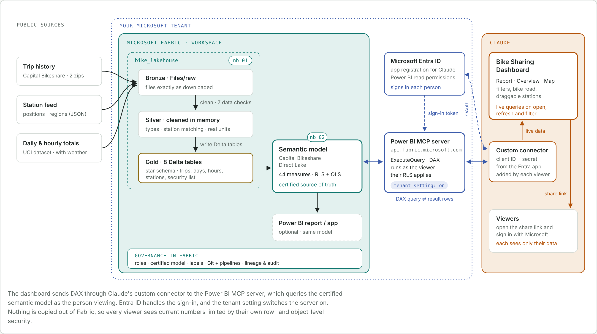

# Capital Bikeshare on Microsoft Fabric

This project takes two years of Washington D.C. bike share data (2011 and 2012) from raw public files to a governed semantic model in Microsoft Fabric, and on to an interactive dashboard built in Claude. Fabric does the importing, cleaning and modelling, and the model's measures are the single definition of every number. The dashboard then tells the story with a written report that rewrites itself as you filter, an animated "bike road", and a station map with draggable bubbles.

The data covers 3,255,678 trips from Capital Bikeshare's public trip records, 194 stations placed using today's station feed, and the UCI Bike Sharing daily and hourly totals with weather (3,292,679 rentals).

## What's here

`fabric/` is the Fabric side, ready to import into a workspace:

- `notebooks/01_build_lakehouse.ipynb` downloads the raw files into a lakehouse, cleans them, runs seven data checks and writes eight Delta tables in a star schema, with descriptions on every table and column.
- `notebooks/02_build_semantic_model.ipynb` builds a Direct Lake semantic model with Semantic Link Labs: relationships, a date table, 44 measures (including narrative text that changes with the filters) and row- and object-level security roles.
- `notebooks/03_export_for_dashboard.ipynb` queries the model with DAX and packs the results into one small zip that the dashboard reads.
- `model/measures.dax` lists every measure and the security rules, ready for Power BI's DAX query view.
- `README.md` is the setup guide, `DATA_DICTIONARY.md` describes every table and column, and `GOVERNANCE.md` covers roles, certification, sensitivity labels, security, change control and audit.
- `src/` holds the code the notebooks are generated from. `spec.py` is the single source for table descriptions, relationships, measures and roles. Change it, then run `gen_notebooks.py` and `gen_nb3.py` to rebuild the notebooks.

`dashboard/` is the source of the Claude dashboard page (`index.html`, `map.js`, `report.js`). It runs inside a Claude Dashboard artifact, which supplies the `dash` data API and the d3 library, so it isn't a standalone web page.

`architecture/` holds the architecture diagram as an HTML page and the image above.

## How it fits together

Notebook 01 fills the lakehouse, notebook 02 builds the model on top, and notebook 03 exports what the dashboard needs. The planned final setup replaces that export with a live link. Microsoft's Power BI MCP server, switched on by a tenant setting and signed in through an Entra app registration, lets the dashboard query the model directly through a Claude custom connector, so each viewer sees only what their own Fabric access and row-level security allow. The diagram shows that live path.

## Running it

See `fabric/README.md`. In short: create a lakehouse called `bike_lakehouse`, import the three notebooks, and run them in order. Notebook 02's last cell and notebook 03's checks compare the results with known totals.

The raw data isn't stored in this repository. Notebook 01 downloads it from the public sources each time.

## Sources

- Capital Bikeshare trip history data: https://capitalbikeshare.com/system-data
- Capital Bikeshare station feed (GBFS): https://gbfs.lyft.com/gbfs/1.1/dca-cabi/en/station_information.json
- Fanaee-T, H. and Gama, J., Bike Sharing Dataset, UCI Machine Learning Repository: https://archive.ics.uci.edu/dataset/275/bike+sharing+dataset
